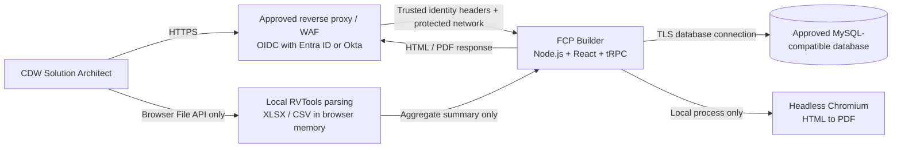
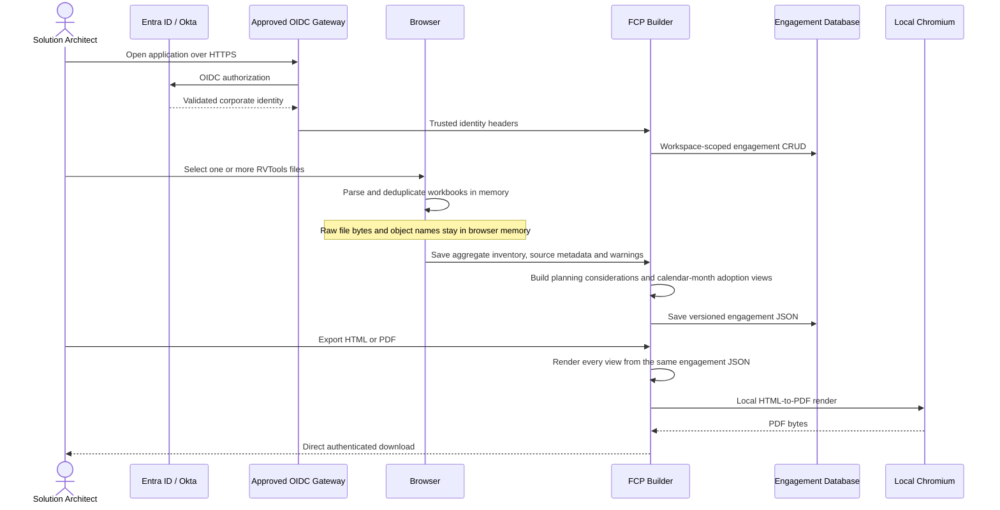

# FCP Builder Security Review Package

## Executive security posture

FCP Builder is a **single-container, authenticated internal application**. RVTools workbooks are parsed in the user’s browser; raw inventory files and per-object records are never uploaded to the application server. The app stores only user-confirmed customer and entitlement fields, aggregate inventory facts, planning considerations, and the two authoritative adoption-plan views as structured JSON in an approved MySQL-compatible database.

The application has one inbound HTTP port, no background workers, no analytics, no telemetry, and no runtime dependency on public internet content. It does not load third-party fonts, scripts, images, or CDNs. PDF rendering occurs locally inside the application container through Chromium.

The preferred CDW deployment places the app behind an existing OIDC-aware gateway integrated with Entra ID or Okta. The gateway owns MFA, conditional access, token validation, and session policy. The app receives only trusted identity headers and contains no password database.

## Logical architecture

## Inventory, engagement, and export data flow

## Data classification and storage

| Data element | Classification | Stored | Location | Notes |
|---|---|---:|---|---|
| Customer name, location, account identifier, and contact | CDW confidential / customer confidential | Yes | Engagement JSON | Access is workspace-scoped (see Authentication and authorization). |
| Entitled physical cores, dollar value, and start/end dates | CDW confidential / customer confidential | Yes | Engagement JSON | Drives entitlement-term summaries and calendar-month views. |
| Funding source and BSAS (Broadcom Software Adoption Services) hours and term dates | CDW confidential / customer confidential | Yes | Engagement JSON (`fields.fundingSource`, `bsasHours`, `bsasStart`, `bsasEnd`) | Funding is entitlement only, entitlement + BSAS, or BSAS only. BSAS is hours and dates only: the BSAS dollar amount, its rates and its rate tier are Broadcom-internal and are never stored, because the engagement document is held in the browser. The planner enters BSAS hours on the Engagement step, and the brief import reads only `bsas.hours`, `termStart` and `termEnd` (any other key is dropped with a warning). Exports show BSAS as hours and dates. A BSAS-only Condensed FCP must carry no dollar figure at all; its content gate blocks any. `server/condensedFcp.test.ts` and `server/bsas.test.ts` cover both. |
| Raw RVTools workbook bytes | Customer confidential | No | Browser memory only | Never submitted to the application API. |
| VM, host, datastore, and network object names | Customer confidential | No | Browser memory only | Used transiently for local deduplication, then discarded. |
| Aggregate counts, capacities, versions, and hardware-model totals | Customer confidential | Yes | Engagement JSON | Contains no per-object inventory rows. |
| RVTools source filename, size, worksheet list, and parser warnings | Customer confidential | Yes | Engagement JSON | Supports traceability without storing workbook content. |
| Planning considerations and both adoption-plan views | Customer confidential | Yes | Engagement JSON | Editable structured data derived from confirmed fields and aggregate inventory. |
| Customer brief content (contacts and personnel names, what we heard, open questions and items, milestones, resource-assignment hours) | Customer confidential / internal personal data | Yes | Engagement JSON (`report`) | Imported from the Copilot customer brief JSON in the browser; the file itself is not uploaded. Workspace-scoped like the rest of the engagement. |
| Internal rate card and staffing mix | CDW confidential | No (code) | Server code only (`server/rateCard.ts`) | Per-role rates never leave the server. The `effort.scoped` procedure returns derived totals (plan cost, cost per work package, the entitlement value, and the threshold status) to the signed-in planner's screens, so hours can be kept inside the entitlement. Under the v2 hours model it also returns the blended rate used to turn the entitlement value into hours, and dollars per bucket, for the planner only; a planner may store an override rate on the engagement (`estimateInputs.blendedRate`). No rate or cost figure is rendered in any exported document; the Condensed FCP content gates allow only the entitlement value as a dollar figure and block "blended rate" and "rate card". |
| User name and email | Internal personal data | Yes | Users table | Supplied by the approved identity provider. Admins see every user's name, email, role, role view, workspace, and last sign-in on the admin screen; the issuer-scoped identity digest (`openId`) is never sent to the browser. |
| Operational settings (stale-stage thresholds, work plan follow-up, expiry bands) | Internal | Yes | `app_settings` | No customer data. Changed only by admins; each change records the admin and time. |
| VSA tracker commercials (entitlement value, estimated deal value, Broadcom PO number, opportunity and Customer IDs, SER number) | CDW confidential | Yes | Engagements table columns | Workspace-scoped. Tagged internal or customer-facing per column in `shared/vsaFields.ts`; only customer-facing columns may reach a customer document, through `customerFacingColumns()`. |
| VSA tracker status (stage, stage history, gate dates, health, notes, source checklist) | CDW confidential | Yes | `engagements`, `stageEvents`, `sourceChainItems` | Workspace-scoped. Stage history is append-only. Source checklist items record file names or folder paths as text; no file content is uploaded or stored. |
| Assignment names, CDW emails, and Broadcom emails | Internal personal data | Yes | `engagementAssignments` | Workspace-scoped. Linked to a user account by CDW email when that person signs in. |
| Client folder link | CDW confidential | Yes | `engagements.clientFolderUrl` | `https://` only. Rendered as a link; the server never fetches it. |
| FCP version history | Customer confidential | Yes | `fcpVersions` (full FCP document snapshots) | Same content and classification as `engagements.data`; no raw RVTools. Made on request, when an FCP leaves FCP Draft, on export, and when a person decides a tracker segment mismatch (reason `decision`). Reached only through a visible engagement and deleted with it (cascade). The engagement-retention period should cover these rows too. |
| Report exports (CSV, XLSX) and saved report definitions | CDW confidential / internal personal data | Definitions yes; exports no server retention | `savedReports` (definitions: columns, filters, grouping, no record data); exports in response or browser memory | Reports run only over records visible to the user, in their role view. CSV is built in the browser from data already shown; XLSX is built in memory on the server from the same query. Both end with the proprietary legend. Saved definitions are workspace-scoped through `server/visibility.ts`; changing or deleting one is limited to its owner or an admin. |
| SharePoint VSA Pipeline List CSV export | CDW confidential / internal personal data | No (file); mapped fields yes | Request memory only; mapped values in engagement columns, `engagementAssignments`, and `engagements.importSnapshot` | A signed-in workspace member selects the export on the Import page; the browser sends its text to `pipelineImport.preview` or `pipelineImport.commit` (5 MB limit). The server parses it in memory and keeps only mapped tracker fields; the file itself is not stored. `importSnapshot` holds the mapped values from the last import, used to tell SharePoint edits from app edits. The list holds no RVTools data. The app does not connect to SharePoint; the file is exported and uploaded by a person. |
| Corporate password, MFA secret, and IdP access token | Restricted | No | Not handled by the app | Remains with Entra ID / Okta and the approved gateway. |
| Database credential and session secret | Restricted secret | No | Runtime secret manager | Never sent to the browser or included in exports. |
| HTML/PDF export bytes | Customer confidential | No server retention | Response memory only | Direct browser download; the temporary Chromium page is closed immediately. |
| Condensed FCP HTML/PDF bytes | Customer confidential | No server retention | Response memory only | Built from the engagement JSON. Content gates run before every download (no rates, PO value, segment, internal tracker or burndown-risk terms, no "readiness"/"workshop"/"TRW", exactly one dollar figure, footed tables, no external scripts or stylesheets); a failed gate returns 409 with the reasons and no file. |
| Building Blocks workbook (XLSX) bytes | Customer confidential | No server retention | Response memory only | Commercial customers only. Built in memory from the engagement JSON as a single sheet (Category, Category Start Date, Block, Status, Projected Dates, Dependencies, Notes) using the block list in `shared/buildingBlocks.ts`; no template file is read; the signed ticket must name both the `xlsx` format and the `building-blocks` document type. |

## Authentication and authorization

The app has no login flow of its own. `FCP_AUTH_MODE=trusted-proxy` activates the corporate identity bridge, and without it no request is authenticated. The reverse proxy must be the only network path to the container and must strip user-supplied identity headers before injecting validated values.

Engagements are visible to every user in the same workspace. All users who pass the gateway join workspace 1 on first sign-in, so assignment to the app at the CDW SSO gateway is the access-control boundary for who can see engagement data. Every engagement query goes through `server/visibility.ts`: reads and edits are limited to the viewer's workspace, and delete is limited to the record's owner or an admin. Tables that hang off an engagement (stage history, source checklist, assignments) are reached only through a visible engagement. `ownerId` is kept on every engagement for attribution, alongside `updatedByUserId`. Tracker edits use optimistic concurrency (`rowVersion`), so one user cannot silently overwrite another's change. An FCP waiver (which lets a record into delivery without FCP approval) is saved only through `tracker.setFcpWaiver`, through the same visibility check and `rowVersion`, and must say who said it, the date, and where; the user who entered it is stored (`fcpWaiverRecordedByUserId`). It never stands in for the work plan acceptance or the PO, and the field patch cannot set it. FCP documents have a build lock: one editor at a time, renewed by a heartbeat, with the server refusing FCP saves and restores from anyone who does not hold it. Signed download tickets carry the requesting user's ID, and the download route reloads that user and rechecks visibility when the link is used. A test (`server/visibility.test.ts`) fails if a `db.ts` function touches engagement data without the helper. The SharePoint import plans and writes only against records visible to the user running it, in one transaction; it never deletes records, and records it changes are attributed to that user (`updatedByUserId`, and `actorUserId` on import stage events). The browser keeps only UI preferences in `localStorage`: the theme, whether the sidebar is collapsed, and named pipeline filters (saved views). None of these hold record data, and the app sets no cookies (the stock sidebar component's state cookie was removed). Every business-data route—engagement CRUD, document preview, HTML export, and PDF export—requires an authenticated user. The only unauthenticated exceptions are the sign-in boundary, OAuth callback/session bootstrap, logout cookie clearing, and the health probe; these return no customer, inventory, timeline, or export data.

## Secrets handling

Secrets are runtime-only values supplied by the approved platform secret manager. They must not be placed in source control, image layers, compose files, tickets, or browser-visible `VITE_*` variables. Required secrets are `DATABASE_URL` and `JWT_SECRET`.

## Network ports and endpoint inventory

| Direction | Port | Protocol | Purpose |
|---|---:|---|---|
| Inbound | Platform-assigned `PORT` (container exposes 3000) | HTTPS terminated upstream; HTTP only on the trusted internal path | Application UI and authenticated API. |
| Outbound | Database-specific, normally 3306 | TLS database protocol | Approved MySQL-compatible database. |
| Local only | None | Process IPC | Node launches container-local Chromium for PDF generation. |

The app makes no outbound calls other than to its database, so the deployment can enforce a database-only egress allowlist. This holds until a specific connector is approved and built. Two seams exist for that day and make no calls themselves: `server/fileSource.ts` (`FILE_SOURCE`, default `references`) and `server/pipelineSource.ts` (`PIPELINE_SOURCE`, default `csv`). Their reserved connector names (`sharepoint`, `salesforce`) are refused at startup, so a configuration change alone cannot open egress. The record Files tab lists links only (the client folder and source references), returns only `https:` URLs, and never fetches, uploads, or stores file bytes; links open in the user's browser. A future connector needs its own review: the egress host, credentials and scopes, and an update here. OIDC traffic occurs at the approved gateway rather than the app. The browser does not call analytics, telemetry, CDNs, remote fonts, compatibility guides, or inventory-analysis services. Chromium renders an in-memory HTML document and does not navigate to external resources.

| Endpoint category | Configuration source | Called by | Data sent | Required in CDW mode |
|---|---|---|---|---:|
| MySQL-compatible database host | `DATABASE_URL` | Server | Users, aggregate engagement JSON, and timestamps | Yes |
| Corporate IdP | Approved gateway configuration | Gateway, not app | OIDC protocol data | Yes at gateway |

## VCF 9.1 planning-consideration boundary

The planning view summarizes RVTools-observable inventory. It can surface observed physical-core totals, ESXi version distributions, inventory health signals, datastore utilization, snapshots, estate scale, and missing RVTools worksheets. It cannot determine firmware/driver compatibility, complete HCL status, network design, identity integration, DNS/NTP correctness, VLAN/IP capacity, rack/power requirements, storage certification, workload dependency, or business change windows. Those items remain subject to the appropriate CDW and vendor processes and are not inserted as activities on either adoption plan.

## Retention and deletion

The app records creation and update timestamps. The deployment owner should apply CDW’s approved engagement-retention period at the database layer. User-initiated deletion (by the record's owner or an admin) removes the engagement row and, by cascade, its stage history, source checklist, and assignments. Database backups and legal holds remain governed by the selected database platform and are outside the application container.

## Development data handling

These controls cover development machines; they do not change the deployed application.

- **No real customer records in the source repository.** Fixtures and tests use fictitious companies. `data/`, `uploads/`, `exports/`, `backups/` and database dumps are git-ignored. Real data on a development machine lives only in its local MySQL database (`DATABASE_URL` in the git-ignored `.env`).
- **Local backups.** `scripts/db-backup.sh` (`pnpm db:backup`) writes a timestamped, owner-only (`0600`) gzip dump of the local database to `backups/`. It runs before every migration (`pnpm db:migrate`). It refuses non-local database hosts unless `FCP_BACKUP_ALLOW_REMOTE=1`, so a shared or production database is never copied onto a laptop by accident.
- **AI coding assistant guardrails.** `CLAUDE.md` forbids Claude Code from reading database rows or customer exports for development work, and from running destructive operations. Version-controlled PreToolUse hooks in `.claude/settings.json` enforce this:
  - `.claude/hooks/guard-bash.sh` denies, before execution, shell commands that drop or truncate tables, delete rows without a narrow `WHERE`, push or drop the schema, restore dumps, remove the MySQL data directory, `data/` or `backups/`, force a `git clean`, or `git reset --hard`. It fails closed.
  - `.claude/hooks/guard-files.sh` stops the assistant from editing the hooks or its settings.

  `server/guardHooks.test.ts` tests both in CI. The hooks inspect commands the assistant runs, not the application's own queries.

## Application security controls

| Control | Implementation |
|---|---|
| Access control | Protected business-data procedures and workspace-scoped database predicates from one helper (`server/visibility.ts`); owner-or-admin delete. |
| Admin area | Every procedure under `admin.*` is an `adminProcedure` (`server/_core/trpc.ts`), which refuses any user whose `users.role` is not `admin`; hiding the navigation entry is not relied on. `server/admin.test.ts` calls every admin procedure as a non-admin and as a signed-out caller and expects a refusal. Role changes are attributed (`users.updatedByUserId`), and demoting the last admin is refused inside a locking transaction. A user's profile lists their assignments and recent activity only on records visible to the admin (`visibleEngagements`). The integration status panel is read-only: the admin router has no procedure that changes a source or flag (also tested), so going live stays an environment change plus an IT approval record. |
| Password elimination | Corporate OIDC gateway; no local password collection. |
| Raw inventory minimization | Browser-only XLSX/CSV parsing; no file-upload procedure and no workbook storage. |
| Input validation | Zod schemas for the versioned engagement document, minimal fields, aggregate inventory, and both adoption views. |
| Parser limits | File-count, file-size, and extension checks before local parsing. |
| Duplicate control | Stable UUID/ID keys where present, with scoped name-based fallback keys. |
| Planning transparency | Every planning consideration includes status, observed evidence, and an explicit non-assessable boundary. |
| Injection resistance | Drizzle parameterized queries, context-escaped HTML export values, and XML-escaped workbook cell values. |
| Export integrity | One renderer derives inventory, planning considerations, Adoption Timeline, and Two-Year Notional Adoption Plan from one engagement JSON and removes unresolved tokens. |
| Data-egress minimization | No analytics, telemetry, CDNs, remote fonts, or public inventory services. The UI typeface is bundled into the client build. |
| Container minimization | Node 22 slim plus Debian Chromium and CA certificates; one application process. |
| Availability | Stateless request handling except database state; no in-container cron or detached worker. |

## Review assumptions and required deployment controls

The reverse proxy is assumed to enforce TLS, corporate device/access policy, authenticated access, and request-size limits before forwarding traffic. Direct container access must be blocked. The database must enforce TLS, least-privilege credentials, encryption at rest, backups, and an approved retention policy. The platform should deny general internet egress from the application container and allow only the approved database destination in CDW trusted-proxy mode.
