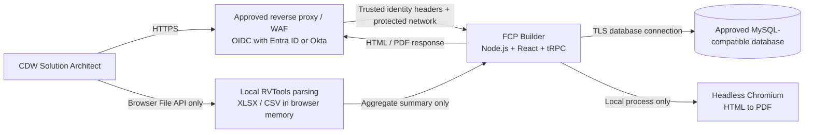
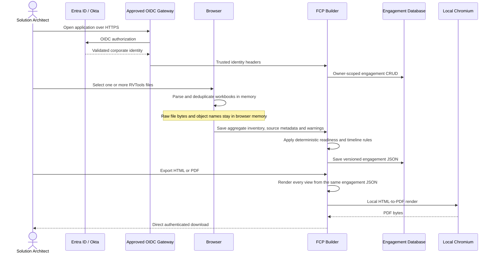

# FCP Builder Security Review Package

## Executive security posture

FCP Builder is a **single-container, authenticated internal application with no AI dependency**. RVTools workbooks are parsed in the user’s browser; raw inventory files and per-object records are never uploaded to the application server. The app stores only user-confirmed customer fields, aggregate inventory facts, transparent readiness indicators, and the authoritative timeline as structured JSON in an approved MySQL-compatible database.

The application has one inbound HTTP port, no background workers, no analytics, no telemetry, no public AI or LLM endpoint, and no runtime dependency on public internet content. It does not load third-party fonts, scripts, images, or CDNs. PDF rendering occurs locally inside the application container through Chromium.

The preferred CDW deployment places the app behind an existing OIDC-aware gateway integrated with Entra ID or Okta. The gateway owns MFA, conditional access, token validation, and session policy. The app receives only trusted identity headers and contains no password database.

## Logical architecture

## Inventory, engagement, and export data flow

## Data classification and storage

| Data element | Classification | Stored | Location | Notes |
|---|---|---:|---|---|
| Customer name, location, account identifier and contact | CDW confidential / customer confidential | Yes | Engagement JSON | Access is owner-scoped by authenticated user ID. |
| Entitled physical cores and entitlement dates | CDW confidential / customer confidential | Yes | Engagement JSON | Compared with observed cores only as a planning indicator; not a licensing determination. |
| Raw RVTools workbook bytes | Customer confidential | No | Browser memory only | Never submitted to the application API. |
| VM, host, datastore and network object names | Customer confidential | No | Browser memory only | Used transiently for local deduplication, then discarded. |
| Aggregate counts, capacities, versions and hardware-model totals | Customer confidential | Yes | Engagement JSON | Contains no per-object inventory rows. |
| RVTools source filename, size, worksheet list and parser warnings | Customer confidential | Yes | Engagement JSON | Supports traceability without storing workbook content. |
| Readiness indicators, timeline and rule rationale | Customer confidential | Yes | Engagement JSON | Generated by transparent local deterministic rules. |
| User name and email | Internal personal data | Yes | Users table | Supplied by the approved identity provider. |
| Corporate password, MFA secret and IdP access token | Restricted | No | Not handled by the app | Remains with Entra ID / Okta and the approved gateway. |
| Database credential and session secret | Restricted secret | No | Runtime secret manager | Never sent to the browser or included in exports. |
| HTML/PDF export bytes | Customer confidential | No server retention | Response memory only | Direct browser download; the temporary Chromium page is closed immediately. |

## Authentication and authorization

In hosted review environments, Manus OAuth is used. In CDW self-hosted mode, `FCP_AUTH_MODE=trusted-proxy` activates the corporate identity bridge. The reverse proxy must be the only network path to the container and must strip user-supplied identity headers before injecting validated values.

Every engagement query includes the authenticated local `ownerId`. Create, read, update, duplicate, and delete operations cannot access another user’s rows. Every business-data route—engagement CRUD, document preview, HTML export, and PDF export—requires an authenticated user. The only unauthenticated exceptions are the sign-in boundary, OAuth callback/session bootstrap, logout cookie clearing, and the health probe; these return no customer, inventory, timeline, or export data.

## Secrets handling

Secrets are runtime-only values supplied by the approved platform secret manager. They must not be placed in source control, image layers, compose files, tickets, or browser-visible `VITE_*` variables. Required secrets are `DATABASE_URL` and `JWT_SECRET` in hosted OAuth mode. **There is no LLM endpoint, API key, model deployment name, or AI credential.**

## Network ports and endpoint inventory

| Direction | Port | Protocol | Purpose |
|---|---:|---|---|
| Inbound | Platform-assigned `PORT` (container exposes 3000) | HTTPS terminated upstream; HTTP only on the trusted internal path | Application UI and authenticated API. |
| Outbound | Database-specific, normally 3306 | TLS database protocol | Approved MySQL-compatible database. |
| Outbound | 443 | HTTPS | Hosted OAuth services only in the Manus-hosted review mode. Not used by the app in CDW trusted-proxy mode. |
| Local only | None | Process IPC | Node launches container-local Chromium for PDF generation. |

The CDW trusted-proxy deployment can enforce a database-only application egress allowlist. OIDC traffic occurs at the approved gateway rather than the app. The browser does not call any model, analytics, telemetry, CDN, remote-font, compatibility-guide, or inventory-analysis service. Chromium renders an in-memory HTML document and does not navigate to external resources.

| Endpoint category | Configuration source | Called by | Data sent | Required in CDW mode |
|---|---|---|---|---:|
| MySQL-compatible database host | `DATABASE_URL` | Server | Users, aggregate engagement JSON and timestamps | Yes |
| Hosted OAuth service | `OAUTH_SERVER_URL` | Server | OAuth code exchange and hosted identity | No |
| Hosted login portal | `VITE_OAUTH_PORTAL_URL` | Browser | OAuth navigation | No |
| Corporate IdP | Approved gateway configuration | Gateway, not app | OIDC protocol data | Yes at gateway |

## VCF readiness assessment boundary

The readiness view is an **inventory-informed pre-assessment**, not certification. It can surface observed physical-core totals, ESXi version distributions, inventory health signals, datastore utilization, snapshots, estate scale, and missing RVTools worksheets. It cannot determine firmware/driver compatibility, complete HCL status, network design, identity integration, DNS/NTP correctness, VLAN/IP capacity, rack/power readiness, storage certification, workload dependency, or business change windows. Those remain explicit validation tasks in the plan.

## Retention and deletion

The app records creation and update timestamps. The deployment owner should apply CDW’s approved engagement-retention period at the database layer. User-initiated deletion removes the owner-scoped engagement row. Database backups and legal holds remain governed by the selected database platform and are outside the application container.

## Application security controls

| Control | Implementation |
|---|---|
| Access control | Protected business-data procedures and owner-scoped database predicates. |
| Password elimination | Corporate OIDC gateway or hosted OAuth; no local password collection. |
| Raw inventory minimization | Browser-only XLSX/CSV parsing; no file upload procedure and no workbook storage. |
| AI elimination | No LLM module, model endpoint, model credential, AI API route, or AI-generated content path. |
| Input validation | Zod schemas for the versioned engagement document, minimal fields, aggregate inventory and timeline. |
| Parser limits | File count, file-size and extension checks before local parsing. |
| Duplicate control | Stable UUID/ID keys where present, with scoped name-based fallback keys. |
| Readiness transparency | Every indicator includes status, observed evidence and an explicit non-assessable boundary. |
| Injection resistance | Drizzle parameterized queries and context-escaped HTML export values. |
| Export integrity | One renderer derives inventory, readiness and timeline views from one engagement JSON and removes unresolved tokens. |
| Data egress minimization | No analytics, telemetry, CDNs, model endpoints or public inventory service. |
| Container minimization | Node 22 slim plus Debian Chromium and CA certificates; one application process. |
| Availability | Stateless request handling except database state; no in-container cron or detached worker. |

## Review assumptions and required deployment controls

The reverse proxy is assumed to enforce TLS, corporate device/access policy, authenticated access and request-size limits before forwarding traffic. Direct container access must be blocked. The database must enforce TLS, least-privilege credentials, encryption at rest, backups, and an approved retention policy. The platform should deny general internet egress from the application container and allow only the approved database destination in CDW trusted-proxy mode.
