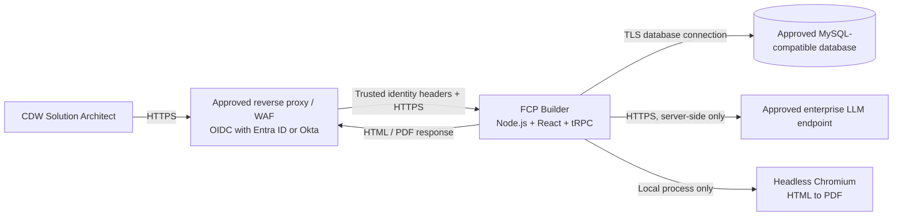
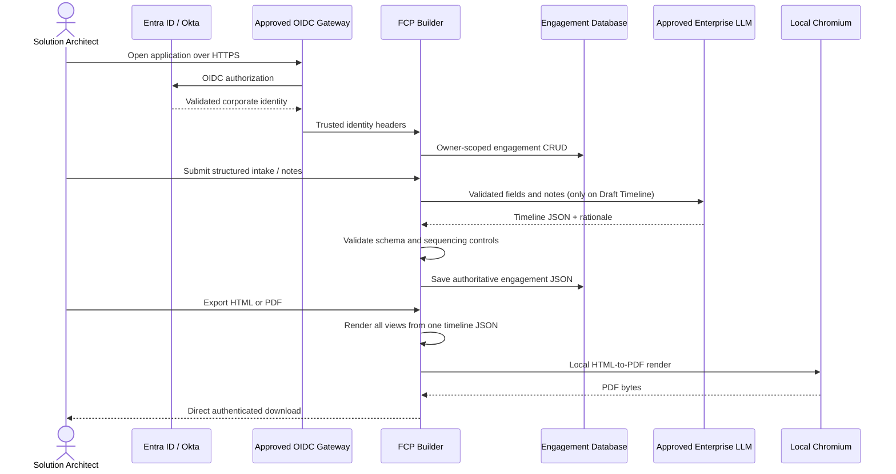

# FCP Builder Security Review Package

## Executive security posture

FCP Builder is a **single-container, authenticated internal application**. It stores engagement intake and the authoritative timeline as structured JSON in an approved MySQL-compatible database. It has one inbound HTTP port and no background workers. It does not load third-party fonts, analytics, scripts, images, or CDNs. PDF rendering occurs locally in the container through Chromium.

The CDW self-hosted pattern places the app behind an existing OIDC-aware gateway integrated with Entra ID or Okta. The gateway owns MFA, conditional access, token validation, and session policy. The app receives only trusted identity headers from that gateway and contains no password database.

## Logical architecture

## Engagement and export data flow

## Data classification and storage

| Data element | Classification | Stored | Location | Notes |
|---|---|---:|---|---|
| Customer name, location, estate notes | CDW confidential / customer confidential | Yes | Engagement JSON | Access is owner-scoped by authenticated user ID. |
| Commercial entitlement, tokens, labor pool | CDW confidential / customer confidential | Yes | Engagement JSON | No values are invented by AI or templates. |
| VCF estate, migration, DR, security details | Customer confidential | Yes | Engagement JSON | Included in LLM calls only when the user explicitly requests a draft. |
| Timeline and rationale | Customer confidential | Yes | Engagement JSON | Validated before save and export. |
| User name and email | Internal personal data | Yes | Users table | Supplied by the approved identity provider. |
| Corporate password, MFA secret, access token | Restricted | No | Not handled by application | Remains with Entra ID / Okta and the approved gateway. |
| LLM API key, database credential, JWT secret | Restricted secret | No | Runtime secret manager | Injected as environment variables; never sent to the browser. |
| HTML/PDF export bytes | Customer confidential | No server retention | Response memory only | Browser download; temporary PDF page is closed immediately. |

## Authentication and authorization

In hosted review environments, Manus OAuth is used and all engagement, AI, preview, and export procedures use the protected API contract. In CDW self-hosted mode, `FCP_AUTH_MODE=trusted-proxy` activates the corporate identity bridge. The reverse proxy must be the only network path to the container and must strip user-supplied identity headers before injecting validated values.

Every engagement query includes the authenticated local `ownerId`. Create, read, update, duplicate, and delete operations cannot access another user's rows. Every business-data route—engagement CRUD, AI drafting, document preview, HTML export, and PDF export—requires an authenticated user. The only unauthenticated exceptions are the sign-in boundary, OAuth callback/session-bootstrap procedures, logout cookie clearing, and the health probe. These exceptions return no engagement, customer, timeline, or export data and are required to establish or monitor authenticated service access.

## Secrets handling

Secrets are runtime-only values supplied by the approved platform secret manager. They must not be placed in source control, image layers, compose files, tickets, or browser-visible `VITE_*` variables. Required secrets are `DATABASE_URL`, `JWT_SECRET` in hosted OAuth mode, and `FCP_LLM_API_KEY` when an enterprise LLM is configured.

## Network ports

| Direction | Port | Protocol | Purpose |
|---|---:|---|---|
| Inbound | Platform-assigned `PORT` (container exposes 3000) | HTTPS terminated upstream; HTTP inside trusted network | Application UI and authenticated API. |
| Outbound | 443 | HTTPS | Approved LLM endpoint when Draft Timeline is invoked. |
| Outbound | Database-specific, normally 3306 | TLS database protocol | Approved MySQL-compatible database. |
| Outbound | 443 | HTTPS | Hosted OAuth services only in Manus-hosted mode. In CDW trusted-proxy mode, OIDC is handled by the gateway rather than the app. |
| Local only | None | Process IPC | Node launches container-local Chromium for PDF generation. |

## Complete outbound endpoint list

The application code has **no hardcoded customer-data destinations**. The review team should populate the actual allowlist from deployment configuration.

| Endpoint category | Configuration source | Called by | Data sent | Required in CDW mode |
|---|---|---|---|---:|
| Enterprise LLM chat-completions URL | `FCP_LLM_ENDPOINT` | Server | Validated intake fields, notes, sequencing rules | Only for AI drafting |
| MySQL-compatible database host | `DATABASE_URL` | Server | Users, engagement JSON, timestamps | Yes |
| Hosted OAuth service | `OAUTH_SERVER_URL` | Server | OAuth code exchange and hosted identity | No when trusted proxy is used |
| Hosted login portal | `VITE_OAUTH_PORTAL_URL` | Browser | OAuth navigation | No when trusted proxy is used |
| Corporate IdP issuer | Gateway configuration; namespaced in `FCP_OIDC_ISSUER` | Gateway, not app | OIDC protocol data | Yes at the gateway |

There are no analytics, telemetry, crash-reporting, CDN, remote font, or remote asset endpoints. Chromium receives a local in-memory HTML document and does not navigate to external resources.

## Retention and deletion

The app records `createdAt` and `updatedAt`. The deployment owner should apply CDW's approved engagement-retention period at the database layer. User-initiated deletion removes the owner-scoped engagement row. Database backups and legal holds remain governed by the selected database platform and are outside the application container.

## Application security controls

| Control | Implementation |
|---|---|
| Access control | Protected business-data tRPC procedures and owner-scoped database predicates; explicitly documented non-data login and health exceptions. |
| Password elimination | Corporate OIDC gateway or hosted OAuth; no local password collection. |
| CSRF/session protection | Hosted OAuth state validation and secure session-cookie settings from the platform scaffold. |
| Input validation | Zod schemas for the full engagement document, fields, timeline, and API inputs. |
| AI output validation | Strict JSON schema request followed by local Zod validation and deterministic fallback. |
| Injection resistance | Drizzle parameterized queries and context-escaped HTML export values. |
| Export integrity | One renderer derives every view from one timeline JSON and replaces unresolved `[[...]]` tokens. |
| Data egress minimization | No analytics/CDNs; only configured DB, IdP mode, and approved LLM. |
| Container minimization | Node 22 slim plus Debian Chromium and CA certificates; one application process. |
| Availability | Stateless request handling except database state; no in-container cron or detached worker. |

## Review assumptions and required deployment controls

The reverse proxy is assumed to enforce TLS, corporate device/access policy, request-size limits, and authenticated access before forwarding traffic. Direct container access must be blocked. The database must enforce TLS, least-privilege credentials, encryption at rest, backups, and an approved retention policy. The enterprise LLM must be approved for the intended customer-data classification and configured for no training and no cross-tenant retention.
